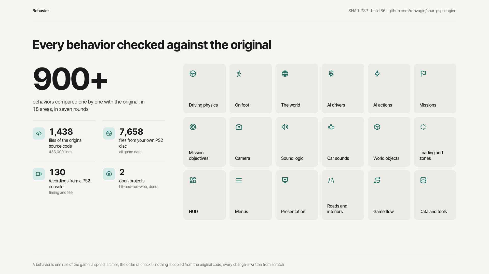
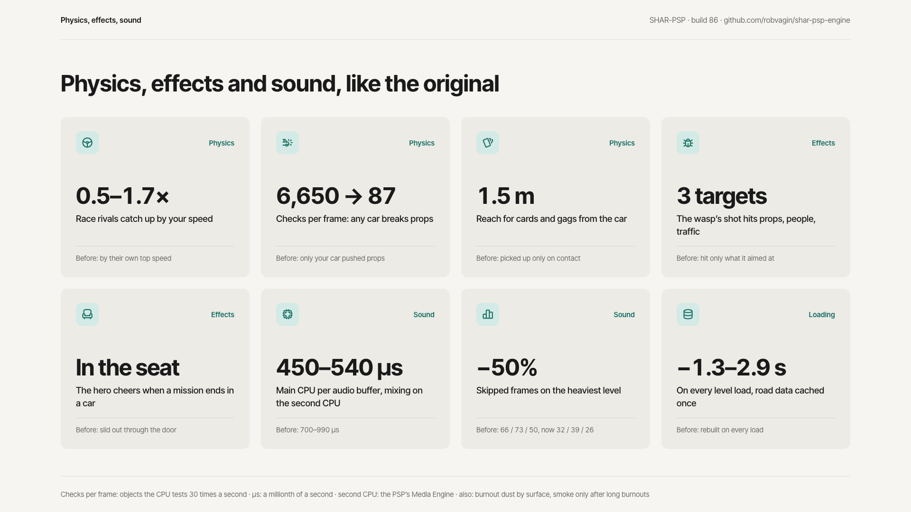
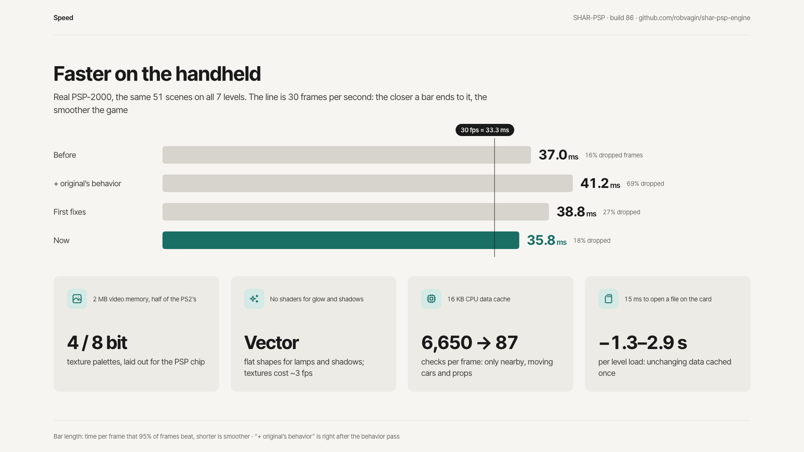
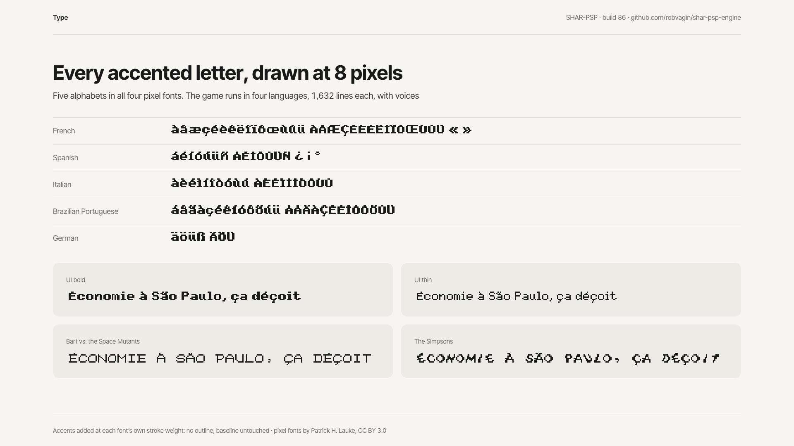
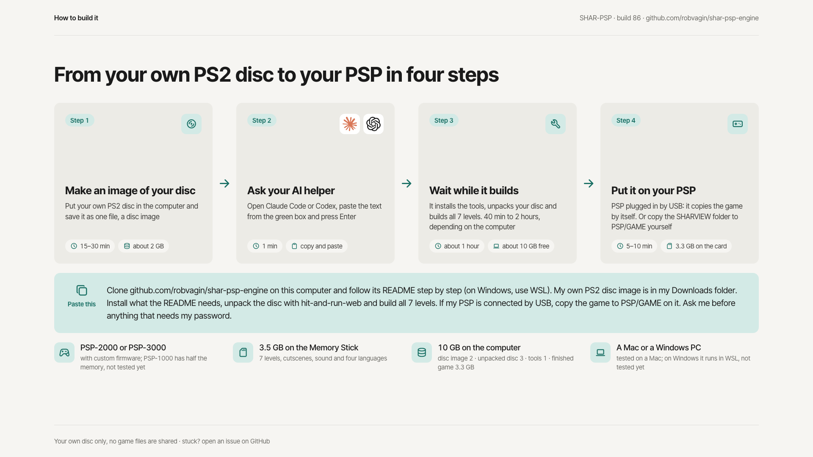

# Build 86 in pictures

The slides from the build 86 post. Numbers come from hardware tours on a PSP-2000; how each one is measured is in [status](../status.md).

Back to the [documents](../index.md).
